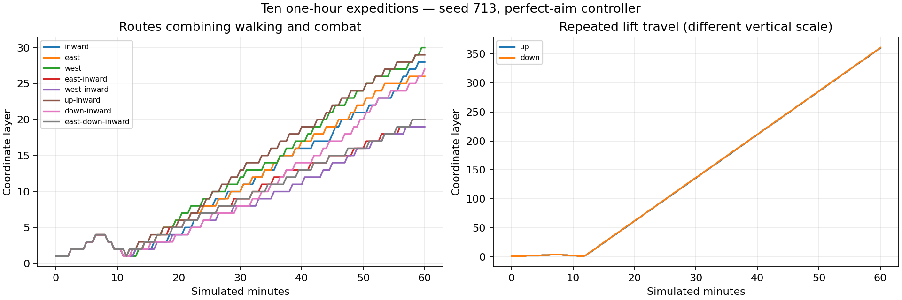

# Ten deep directional expeditions — revised design review

P1 follow-up (7 November): [implemented regional variety, alien prototypes, optional encounters and local consequences](../../../REGIONAL_ENCOUNTERS.md).

P0 follow-up (7 November): [implemented navigation/HUD improvements, seed-3 diagnosis and imperfect-input journeys](../../../NAVIGATION.md). The observations below describe the original reviewed build.

This extends [the first review](../2026-11-06-expeditions/README.md). It records ten additional **60-minute simulated expeditions: ten simulated hours**, accelerated rather than ten hours of human or real-time rendered play. Game code is still `537f785`; the intervening commit only added the first review. No balance, generator or enemy changes were made for this investigation.

## Method

All ten characters begin fresh on **seed 713**, earn the foothold and four guardian phases normally, then follow different directional itineraries. Keeping the seed and earned build policy constant isolates direction; these are not ten independent ship seeds. Before phase four the common route is a control, not ten independent confirmations of early-game pacing.

The retained [driver](data/deep-driver.c) uses movement, aiming, firing, lift, interaction, upgrade and reward APIs. It never writes the player's position, grants equipment, bypasses phase barriers, deletes enemies or injects damage. It has perfect aim and reads generated doors. It retains the starter carbine and the previous automatic upgrade policy, so this is a strong, informed baseline, not human difficulty or a comparison of builds. After unlocking phase four, directional waypoints replace story objectives: **these runs do not evaluate story extraction or completion**.

Two important improvements over the first review's bot are a rolling navigation window (the old fixed map could not reach deep coordinates) and a five-second no-progress response that uses ordinary strafe, forward and jump inputs before replanning. Recovery actions are logged. Up/down routes repeatedly use the grav lift at the same hull-side column; their distance measures vertical transit, not walking through hundreds of fully explored rooms. Horizontal and diagonal routes include substantially more walking between connections.

Each run has 216,000 fixed 1/60-second updates, per-cell entry telemetry, 30-second status samples, saves at 15/30/45/60 minutes, and a checkpoint on reaching a new maximum layer. [Summary](data/summary.json), raw logs, execution times and saves are retained. The `deepest` save is the last such checkpoint, not necessarily the hour-end position. Screenshot replays use the actual browser Import UI, with native save-loading/floor-support checks and recorded renderer state. All 30 scheduled checkpoint imports were verified on supported floors in ready rooms, with no world failure; the native and WebGL checks succeeded. Reloads reconstruct populations and can normalize a lift transit to a landing; screenshots are checkpoint replays, not continuous video.

## Results

| Direction | Maximum coordinate layer | Approximate hour-end position, km (x / y / inward z) | Kills | Deaths | Rank | Recovery actions |
| --- | ---: | --- | ---: | ---: | ---: | ---: |
| Inward | 28 | 0.03 / 0 / 10.50 | 2,731 | 0 | 84 | 3 |
| East | 26 | 9.86 / 0 / 0.24 | 2,505 | 0 | 83 | 0 |
| West | 30 | −11.33 / 0 / 0.17 | 2,570 | 0 | 82 | 0 |
| Up | 360 | 0 / 46.07 / 0.23 | 2,606 | 0 | 82 | 0 |
| Down | 361 | 0 / −46.07 / 0.23 | 2,781 | 0 | 84 | 0 |
| East + inward | 20 | 7.49 / 0 / 7.58 | 2,657 | 0 | 84 | 0 |
| West + inward | 19 | −7.10 / 0 / 7.26 | 2,738 | 0 | 83 | 0 |
| Up + inward | 29 | 0 / 3.58 / 11.03 | 3,012 | 0 | 88 | 1 |
| Down + inward | 27 | 0 / −3.26 / 10.00 | 3,554 | 0 | 96 | 0 |
| East + down + inward | 20 | 7.39 / −2.43 / 7.60 | 3,238 | 0 | 93 | 0 |

Layer is the game's region-based depth measure, not room count or a metric distance. The one-layer up/down asymmetry follows the signed cell boundaries. Maximum coordinates can occur during lift transit. In particular, native checks of the upward/downward `deepest` saves restore supported landings at **layers 359 and 360**, respectively, rather than the in-transit maxima 360 and 361. This is genuine deep save/reload coverage, with a different traversal experience from the walked routes.

All ten runs completed 3,600 simulated seconds, returned success and had zero respawns. Together they recorded **28,392 kills**. Neither this nor perfect-aim survival establishes that a human would find the game easy. Distinct cell counts and room-form/theme observations are in the summary; they count cells entered, including brief vertical transit, rather than rooms thoroughly searched.



The lift routes use their own vertical scale in the chart. Values come from the periodic samples; exact maxima in the table come from cell-entry events.

## What the deeper runs change in the first review

### Direction is working, but environmental expression becomes uniform

For this seed, east becomes hot, west cold, up orderly and down chaotic. Inward increases the alien trait. By the late portions of the routes, the relevant traits have reached their limits. This is observed in telemetry and agrees with the seeded axis calculation in `campaign_traits`.

During minutes 30–60, **every logged east-only and east-plus-inward cell entry had ember weather** (129 and 133 entries), while **every west-only and west-plus-inward entry had cryogenic mist** (127 and 131). The east/down/inward route had 145 ember entries and four steam entries. These are cell-entry counts, not percentages of playtime or independent random samples.

The original proposal to make directions strongly characteristic is fulfilled. The next step should be **variety within that characteristic**, not weakening the axes. A hot luxury bath, hot machine deck and hot archive should express heat differently: boiling pools, pressure vents, warped shelves and ash, rather than broadly sharing ember precipitation. Likewise, cold districts can have brittle ice, condensation, frozen organisms, drifting crystals or quiet clear air. Derive effects from the function and local incident, with the axis setting the larger palette and risk.

The ecology system makes this more important: `habitat_plan` selects the cold-adapted ecology whenever cryogenic climate wins. A dominant climate can therefore narrow both the weather and encounter grammar. Preserve recognizable adaptation while allowing several compatible behaviors and local exceptions.

### Further numerical depth does not currently create further systemic escalation

This is stronger evidence than the first review's short runs: the same starter-carbine policy survives routes reaching layer 30 and repeated lift transit beyond layer 350. However, the controller never voluntarily tests the earned alternatives, and transient damage can occur between samples.

Source inspection explains part of the plateau: directional heat/order clamp at ±3, alien intensity at 3, and ordinary enemy starting health in `campaign_populate` adds at most 80 health after layer eight. This cap deliberately keeps hordes killable. These runs do **not** justify removing that design choice or scaling every enemy's health indefinitely.

Revise the earlier reward proposal into **optional deep-frontier encounters with new decisions**: support networks, shields with readable vulnerable sectors, asymmetric terrain advantages, district hazards and rare specialists. Keep the ordinary swarm fragile. Offer deeper contracts or relic evolutions tied to the chosen direction, with visible risk and a useful reward, rather than endless passive stat increases.

### Vertical access can outrun room-scale exploration

The pure up/down routes entered all 28 theme labels, but their telemetry recorded **no macro footprint form** beyond ordinary rooms. The mixed up/inward and down/inward routes encountered all eight forms. Rapidly traversing a reserved service column samples the ship very differently from entering its halls.

Consequently, “many themes seen” and “hundreds of layers reached” are poor exploration-success measures by themselves. A player could fly past the most interesting architecture. Preserve useful lifts, but make arrival points invite a short local expedition: a view into the hall, a clear optional landmark, an understandable reason to step off, and a route back. Consider express travel between discovered landings while making undiscovered major frontiers distinct stops. Do not force a fight at every floor just to slow the player down.

### Navigation remains a priority, but the first stall was not evidence of a broken generator

These runs needed four recovery actions total: three inward and one up/inward. The other eight routes needed none. Combined with the first review's successful manual movement probe, this supports improving the route driver and vertical feedback before declaring a generation softlock.

It does not clear all navigation risks. One seed and a topology-aware bot cannot establish that every furnished portal is readable or that a novice can locate the right landing. Keep the earlier proposal for next-connection/deck guidance, local landing cues and a manual reproduction of seed 3. Keep recovery events as diagnostics, rather than silently ignoring them in future completion statistics.

### Small-story consequences and human pacing are still open questions

Longer runs did not turn the bot into a narrative playtester. It does not deliberately read local accounts, take most optional discoveries or use shelter/vehicles/hacking strategically. The first review's proposal to give local traces small physical consequences remains promising but **unvalidated** here.

Likewise, an hour of bot play is not grounds to mandate a longer main story. Separate the initial four-phase arc from optional deep expeditions. Human playtests should measure orientation, reward deliberation and voluntary detours, rather than matching the bot's travel rate.

### What the screenshot comparisons add

Thirteen of the 30 scheduled checkpoint views show the Cryosleep Gallery theme; six of ten deepest views do. This is a small, intentionally sparse checkpoint sample on one cryogenic-history ship, not an unbiased frequency estimate. It nevertheless shows why counting all 28 labels over a long run can overstate moment-to-moment variety. The bot also aims toward its route or targets, so these eye-level images are not complete room panoramas. Several tall rooms initially present a similar rectangular threshold. Add a stronger room-specific focal silhouette and invite looking upward or sideways; compare the retained upward views of the branching concourse and hanging-garden footprint. Preserve the dark palette, but distinguish meaningful distant forms from empty blackness.

## Revised enemy priorities

The earlier twelve concepts still stand, but the deep routes suggest giving them **regional roles**, not distributing every new creature uniformly.

| Region or axis | First behavior to prototype | Animation signature | Player response |
| --- | --- | --- | --- |
| High order / upper decks | A nest conductor or machine relay coordinates a small squad into staggered attacks. | Precise synchronized pauses, then one unit moves while the others hold impossible stillness. | Break the visible relay or exploit the gap between commitments. |
| High chaos / lower decks | A linked colony separates around nearby cover and reforms along a visible tether. | Delayed torso follow-through, mismatched limb rhythms, bodies briefly aligning before splitting. | Shoot the shared core/tether; do not require killing rewarded bodies repeatedly. |
| Cold western frontier | A brittle scavenger remains nearly still, then commits to a short burst after its shell visibly cracks. | Slow tension through joints, a clear fracture, then a fast but finite movement. | Interrupt the crack or dodge the committed line; no unannounced instant melee. |
| Hot eastern frontier | A pressure-fed ambusher attacks in the recovery gap after a local vent pulse. | Belly inflation, skin pulling taut, a recoil travelling down the tentacles. | Read both the vent and organism; keep an escape lane and a visible windup. |
| Deep inward / alien saturation | A pendulum gazer keeps its eye level while its body and tentacles move independently; some watch from high galleries. | Stable gaze, delayed body rotation, gripping limbs before the body transfers weight. | Break its exposed aim lock; distinguish observation from an attack commitment. |

These are new proposals, not shipped behaviors. For the first implementation I would retain the earlier backwards pilgrim and pendulum gazer, add a surface-gripping seam-runner, then build one conductor encounter. Test those in contrasting districts before adding colony splitting. The deep study strengthens the case for different decision rules and motion; it does not support adding a large new roster of stat-only variants.

Continue to preserve the fun horde-combat premise: readable bodies and hitboxes, clear preparation, short vulnerability/recovery windows, one reward per real kill and coherent co-op state. Strangeness should live in creature behavior, not forced camera motion or hidden unavoidable punishment.

## Proposed next implementation order

1. **Directional expression:** retain strong global traits but give room functions different weather, evidence and enemy behaviors inside the same extreme. Compare matched hot/cold rooms before and after.
2. **A readable deep-frontier encounter:** one coordinated nest/relay with an optional earned-build reward, keeping fodder quick to kill. Compare starter gun, a selected earned weapon and imperfect aiming.
3. **Traversal invitation and feedback:** make lift arrivals reveal something worth entering, and mark the next useful connection and deck. Reproduce the earlier seed-3 route with manual controls.
4. **Alien animation families:** the three shared prototypes above, with awareness, approach, committed attack and recovery states; then regional variants.
5. **Human first-play review:** revisit phase length, HUD hierarchy and local-story consequences. Avoid deciding those from perfect-map simulations alone.

## Reproduction and gallery

Compile from the repository root after the normal native core build:

```sh
cc -O2 -Isrc docs/reviews/2026-11-06-deep-expeditions/data/deep-driver.c build/libsc_core.a -lm -o /tmp/sc-deep-driver
mkdir -p /tmp/deep-inward
/tmp/sc-deep-driver /tmp/deep-inward 0
```

Route IDs 0–9 follow the table order. The run retains checkpoint saves and writes its telemetry to stdout; redirect it to `run.log`. The rolling door window and anti-stall policy differ from the first review, so route timing should not be attributed solely to the game.

The [screenshot gallery](screenshots/README.md) contains actual imported checkpoint replays at 15 and 45 minutes, plus the deepest checkpoint for each direction. Sidecars identify coordinates, rank, seed, renderer status and the native support check. The [first review](../2026-11-06-expeditions/README.md) is preserved as the original assessment; this document revises its confidence and priorities rather than rewriting that evidence.
