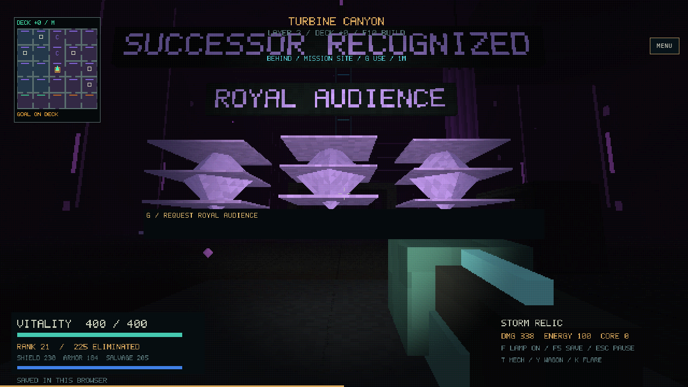
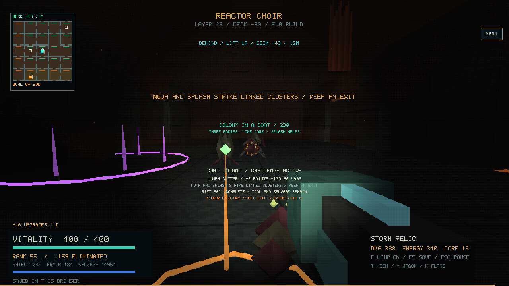
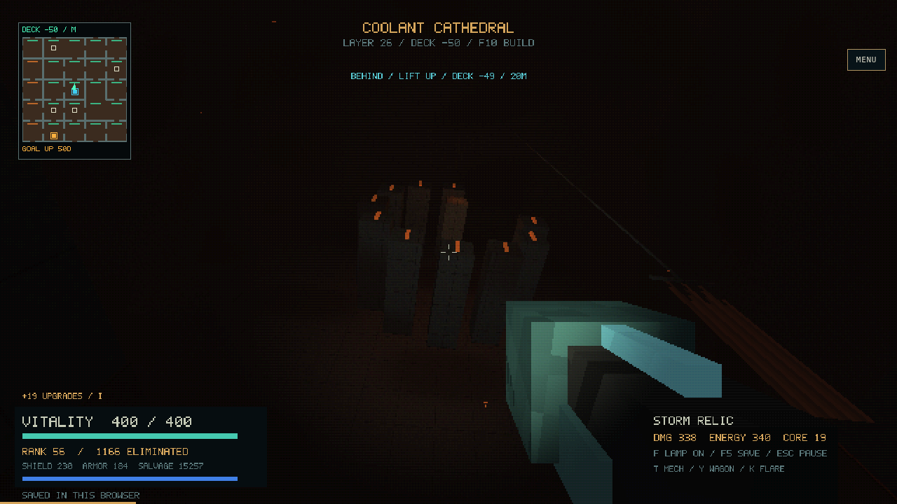

# Earned expedition screenshots

These fourteen images come from actual Chromium/WebGL replays of the long-run
saves. No inspection scenes, position injection or generated artwork are used.
Each PNG has a JSON file of the same name recording the source save/hash,
native validation, WASM hash, before/after state and ordinary camera/movement
actions. Filename run indices start at zero: `07` is report run 08.

Some views include a short walk or camera turn; some include resumed combat and
damage. The two creature views press the normal USE key at an earned encounter
checkpoint. Native headless run totals exclude these browser replay seconds.

**An installed successor in the Parliament of Echoes — seed 109.** The political
aftermath is visible in the world. Large signs and the central interaction bar
also illustrate the presentation issue discussed in the review.

**Colony encounter on deck −50 — seed 314.** The actual enemies, contract effects,
offer and warnings share the view. The many simultaneous text layers make the
combat scene harder to read.

**The broken turbine in the coolant cathedral — seed 314, layer 26.** A real
focal structure lit through the dark atmosphere; the camera turns upward from
the final saved position.

| Capture | What it records |
| --- | --- |
| [Treaty honored](00-changed-court-look.png) | Return to the divided monarch after a supply settlement; short ordinary walk and turn |
| [Court seal, saved view](00-changed-court.png) | Original close view after import, including the transient resume message |
| [Ballroom passage at minute 45](00-minute-45.png) | An ordinary corridor view deep in seed 713; not every room announces its scale |
| [Turbine canyon entrance](00-form-3.png) | A large footprint seen through its approach, before reframing |
| [Reservoir hall](01-form-7.png) | Rain, distant lights and a large dark volume on seed 42 |
| [Survivor conservatory](01-form-1-look.png) | Looking upward toward a real focal structure; incidental enemy damage during replay |
| [Branching concourse](02-minute-45.png) | The saved exploration route, followed by a short normal walk |
| [Rooted structure and survey seal](02-final-look.png) | Focal structure at layer 32; the survey prompt obscures part of the view |
| [Bent arcade, obstructed view](06-form-4-look.png) | Looking toward a structure's coordinates can face a partition; useful negative evidence |
| [Command bridge entrance, obstructed view](07-form-7-look.png) | A second entrance where the intended focus is not exposed from this position |
| [Royal guard encounter](05-court-fight-enemy.png) | Actual robot enemy and matrix-linked encounter after normal USE; overlapping prompts |

The retained dark/obstructed frames are part of the review, not an assertion that
all views are attractive. The [main report](../README.md) separates architectural
variety, visual readability and controller limitations.
