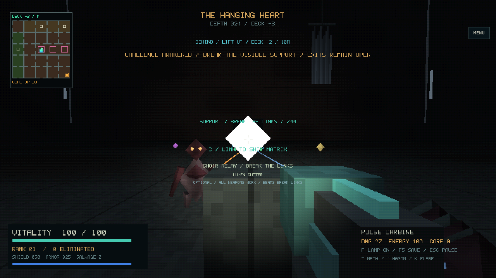
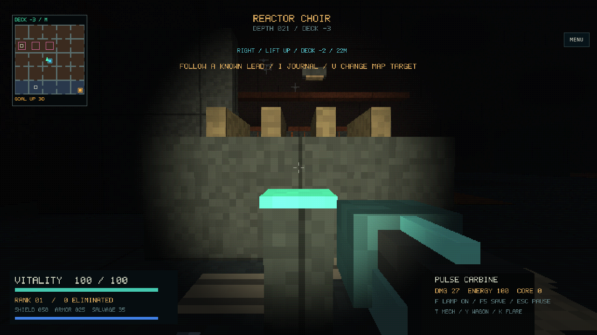
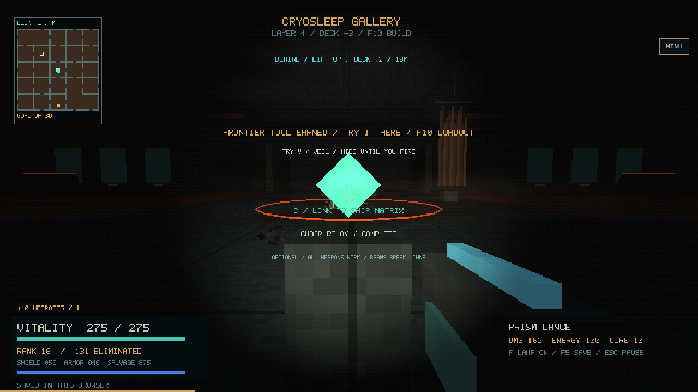

# P1 implementation evidence

See the [complete P1 checklist and playtest instructions](../../../REGIONAL_ENCOUNTERS.md).
These are actual packaged Chromium/WebGL captures at seed 713. Inspection scenes
are saving-disabled; the reward capture imports a checkpoint earned by the native
movement/combat journey. The browser performs activation, firing, claim and Veil
practice through keyboard/mouse input, then verifies IndexedDB resume and touch USE.

- Validation: 32 native CTests; 14 separate gameplay CTests; 31 core sanitizer
  CTests plus focused checks of final fixes; all fifteen packaged browser suites;
  Linux, Windows cross-build and Emscripten; native Mesa and WebGL desktop/touch
  smoke checks. The habitat suite passed after its driver turned toward clear
  floor before deploying shelter.
- [Unit-only core coverage](unit-coverage.json), 7,340/7,451 lines (98.51%).
- [Starter/earned-tool comparison log](combat-comparison.txt): four matched runs with
  limited reaction/turning and aim error, plus the preceding earned-beam acquisition.
- [Fixture provenance](../../../tests/fixtures/README.md).

The existing late-game build clears these encounters quickly. Automated victories
do not establish human challenge or pacing; the human checkpoints in the guide
remain pending. Software rendering and emulated touch are not physical-device tests.

