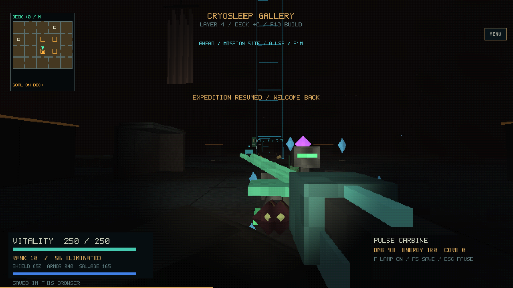
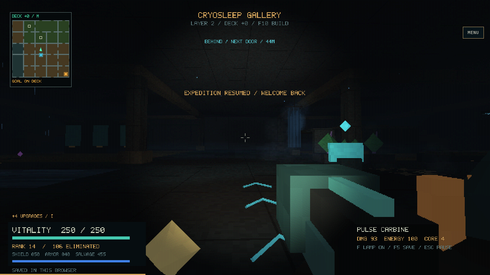
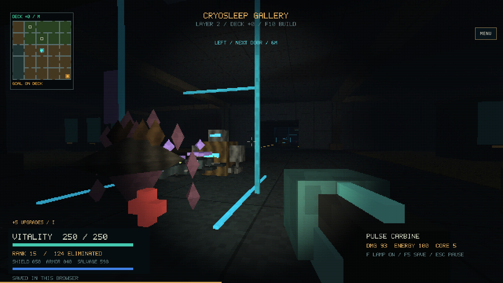
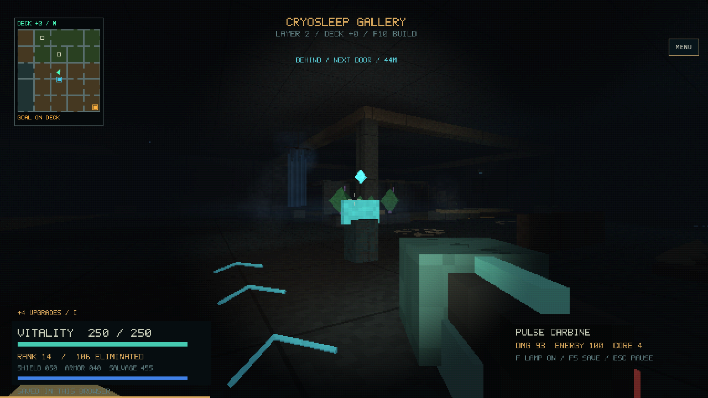
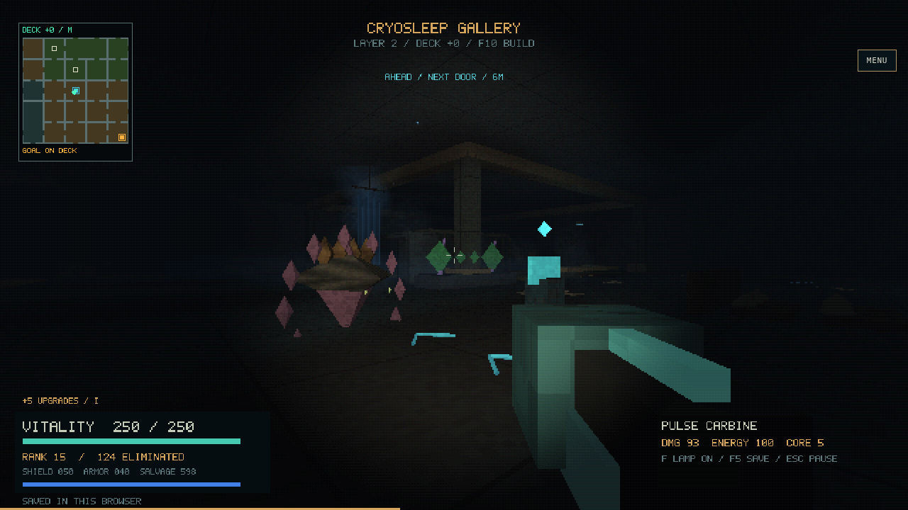
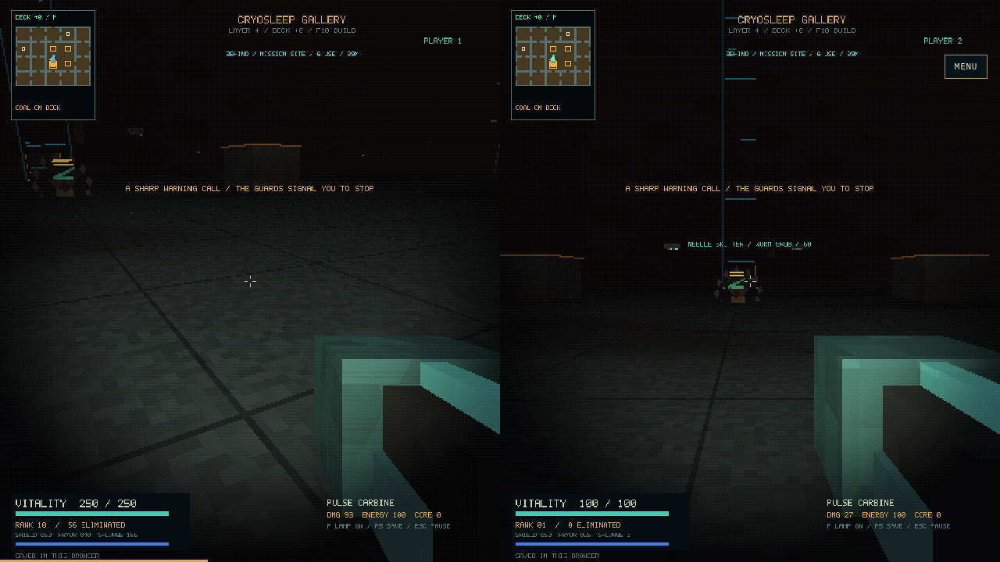
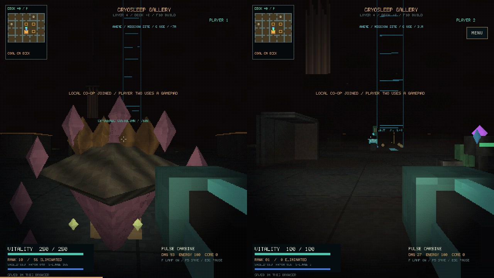
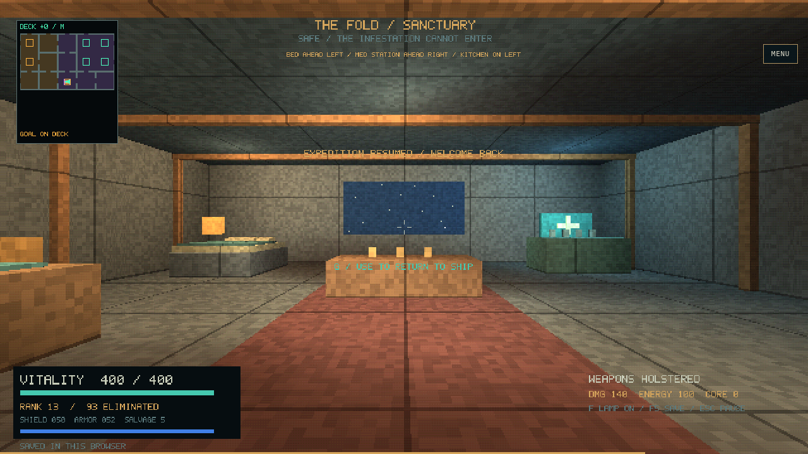

# Captured encounters

These images come from the ordinary release WebAssembly build, using saves
earned by the input-driven journeys. The capture driver imports through the
file UI, turns with mouse input and lets the simulation continue; it does not
place actors or grant equipment. [Build/source hashes](captures/build.json),
[before/after diagnostics](captures/results.json) and the
[driver](data/capture.py) make their provenance inspectable. The separate
`profile-captures` directory uses a review-only timing build and is not the
published game.

## Supply traffic

The carrier was approached through an actual doorway. Its carried blocks and
shaped markings are visible alongside the existing machine model. The close
camera and weapon obscure some of its silhouette; this remains a readability
question for human playtesting.

## Retreat and nearby fighting

The latter view is twelve simulated seconds after importing the revisited
battle checkpoint. The shot counter increases by nineteen while the player does
not fire or gain a kill. This records active NPC attacks; a still image cannot
establish every projectile's target or whether the fight feels understandable.
NPC-versus-NPC targeting, neutral-player protection and reward attribution have
separate unit and journey assertions.

## A station before and after occupation

Both checkpoints are in cell `(1, 0, 7)`, facing the same station from slightly
different approach positions. The [saved state inspection](captures/station-states.jsonl)
records ownership changing from country 1 to country 3 and local casualties
from zero to three. The room's dark power condition is already present in both
checkpoints: this pair demonstrates changed occupation, not a new blackout.
Initial frames, including a close troop obscuring the first view, are retained
alongside these later, clearer frames.

## A nonlethal warning

This final release capture uses the normal F2 join and an emulated gamepad.
Player two fires one starting-carbine shot; the guard survives and raises two
signal bars. The ordinary saved incident records one strike, no report, and
zero strikes for the uninvolved partner. [State/build record](warning-capture/result.json)
and [stereo output](warning-capture/warning.wav) are retained. This is controller
emulation, not physical gamepad testing.

The earlier earned character's carbine killed the same guard in one shot;
that attempt cannot demonstrate the nonlethal grace response. The failed
capture attempts remain available, including a driver which incorrectly waited
on the incoming-player-hit counter and an incomplete mouse API call. None is
counted as a successful warning test.

## Separate views and sanctuary

Player two joins normally with F2; player one walks backwards until their
positions are more than three metres apart. This is a rendered two-view check.
The larger separation, streaming and ownership stress cases are automated core
tests, not implied by this single room capture.

The shelter checkpoint is earned during the first hour-long expedition. Both
strategic suspension and safe recovery are tested independently. This image
does not prove that the invisible director's quiet periods feel well paced.

## Sound and visual observations

Each case retains four seconds of the actual stereo WebAudio output, for
example [convoy](captures/convoy.wav), [battle](captures/battle.wav) and
[split-screen](captures/split-convoy.wav). Samples are finite, non-silent and
unclipped. Directional cases have measurable channel differences; the quiet
shelter mix is centred. These checks do not replace listening to the mix.

The captures preserve the intended darkness, and moving markings, carried
objects and glowing attacks remain visible. Close clusters can crowd the view,
and identification at a distance is weaker than up close. The automated hour
runs also expose overly comfortable strong builds and occasional navigation
recovery. Those are useful follow-up priorities, not evidence that human
readability, difficulty or physical-device performance has passed.
