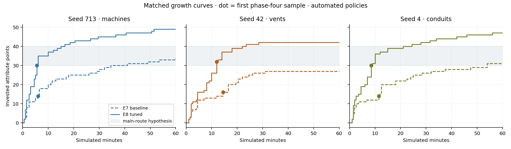
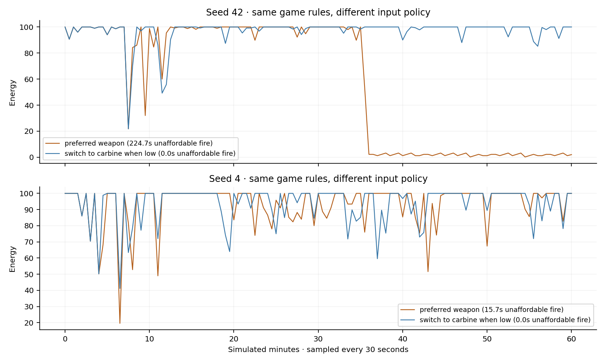
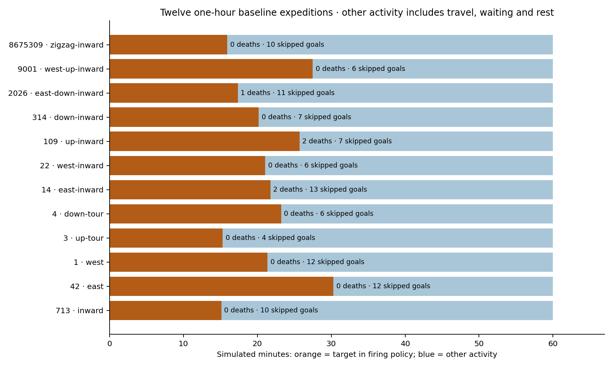

# Integrated expedition review — E8

This review separates implemented behavior, accelerated simulation, rendered
inspection and unavailable human/device evidence. The release uses generator 16,
campaign 2, checkpoint 17 and live snapshot schema 2. Narrative 3, hidden
simulation 1 and matrix generator 1 remain unchanged. Existing published ships
retain their own generator and progression rules.

## What the ten proposals became

| Proposal | Implemented experience | Evidence |
| --- | --- | --- |
| Divergent builds | Eight exclusive branches in four families; earned prerequisites, explicit previews and safe refits | E1/E7 unit, command, save, native/WebGL and Quest fixtures |
| Deliberate hordes | Six bounded recipes with support, commitment and disruption roles | Starter/middle/late victories and condition compatibility cases |
| Transforming guardians | Four patterns, two stages, two breakable systems, physical/optional matrix preparation and persistent breaches | Sixteen primary/alternative fight fixtures, retry/co-op/snapshot cases |
| District journeys | Foundry, Frozen Terrace, Command Reliquary and Transit Garden with connected basic routes and return shortcuts | Forty-eight-seed inventory, eight travel routes, native/WASM parity |
| Environmental rules | Warned conductive water, timed frost sweeps and powered living conduits; permanent basic safe routes | Warning/damage/isolation tests and actual rendered states |
| Sustained hidden campaigns | Supply leads to siege; repaired factories support reinforcements; interruption changes later forces | Paired intervention/ignore and distant revisit cases |
| Recurring individuals | Two or three stable people selected from six roles, with knowledge, travel, consequences and fallback records | Repeated meetings, all motives/roles, persistence and continued commissions |
| Shelter preparation | Optional meals, shared refit bench, personal respec, limited flare calibration, condition research and six keepsakes | Zero-resource recovery, purchases, two occupants and checkpoint/live-state tests |
| Longer director sequences | Hunter, siege, machinery and discovery sequences with observation protection and real cancellation | Matched director controls, bounded reservations and pause/co-op tests |
| Defining ship complications | Three dominant conditions connect compatible districts, ecology and the generated mission | Compatibility matrix and contrasting ship walkthroughs |

The [rules document](../../../../COHERENT_EXPEDITIONS.md) specifies costs,
durations and limits. The [earlier milestone record](../README.md) retains the
incremental E1–E7 gates and their labelled inspection captures.

## Simulation protocol and provenance

The baseline matrix has twelve seeds, twelve route policies, all three conditions
and all four motivations. Every complete run executes 216,000 fixed ticks:
**60 simulated minutes, not an hour of human play**. Additional matched runs
compare the final growth awards with director on/off, starter-only equipment,
separated local co-op and an energy-aware weapon policy. `runs.md` lists actual
wall times, deaths, investment and skipped goals; `summary.json` retains
resource curves, guardian events, hardware counters and full per-run settings.

The driver uses ordinary movement, aim, fire, interactions, progression and
Session commands. It does not teleport, grant items, remove enemies or alter
engaged statistics. Reaction delay, turn rate and aim error vary across its three
policies. All three reward indices are used; selected policies close and reopen
the reward panel, and the starter run defers its rewards. The co-op partner moves
through the actual world and rejoins after checkpoint resume; it does not shoot.
This is a separation/persistence check, not a two-person enjoyment test.

Every run records its executable hash, real wall time, simulated duration,
checkpoint sizes and peak process RSS. Compressed JSONL traces retain adverse
events and unsuccessful optional detours. Frozen executables and driver sources
allow the comparisons to be replayed even though development format 17 evolved
during E1–E7. Earlier milestone saves need their matching frozen revision.

Several CPU jobs and the browser suite shared a four-core quota during the long
runs. Their CPU percentile samples include scheduler contention and are not FPS.
Review processes were later lowered to nice 10 to protect verification deadlines;
the scheduling record is retained and their wall times include that change.
Headless peak RSS includes the review driver's timing buffers, not just game state.
Peak actor/effect counts are sampled once per simulated second; they are observed
peaks, while unit tests enforce the actual array limits. Branch frame counts mean
equipped, prerequisite-eligible time, not successful effect activations. Separate
inspection fixtures explicitly set up progressed loadouts to exercise every
branch's action; they are not evidence that the long-run agent earned and used
every branch naturally.

```sh
python3 scripts/run-expedition-review.py --binary build/sc_hidden_journey \
  --mode matrix --jobs 2 --output /tmp/new-expedition-matrix
python3 scripts/run-expedition-review.py --binary build/sc_hidden_journey \
  --mode matched --jobs 2 --output /tmp/new-expedition-controls
python3 scripts/run-expedition-review.py --binary build/sc_hidden_journey \
  --mode extras --jobs 2 --output /tmp/new-expedition-extras
```

The retained baseline/tuned comparisons use their frozen driver policy. The final
driver additionally releases its circling behavior when declining an optional
fight; the separate seed-42 navigation control isolates this correction against
the original E7 core. This changes test input, not the game or its enemies.
Its first 70 resource samples exactly match the original run through minute 34.5.
After retreating, it visits 155 distinct cells instead of 107, reaches layer 14
instead of 9, and records 275 kills and one death instead of 187 kills and none.
It still skips ten goals, so this does not establish perfect navigation.

Two additional deliberate reward routes earn Conduit/Focus on seed 713 and
Bastion/Capacitor with a mech on seed 8675309. These use displayed reward choices
and ordinary equipment controls, without grants. They complement the naturally
obtained Veil and Rift branches in the twelve-run matrix. The retained presets
are input policies, not changes to loot offers.

## Integrated results

All **25 expeditions completed 60 simulated minutes**, reached phase four,
resumed a checkpoint and reported no world or save failure. Together they made
699 saves and recorded twelve deaths. The summed process wall time is 13,718.84
seconds; runs overlapped, so this is neither elapsed review time nor human playtime.
The [run table](runs.md) preserves each policy, route, result and wall time.







The starter-only control completed the four phases with no attribute investment,
286 kills and one death. This establishes a basic-equipment route; it also means
human review must check whether guardian pressure is strong enough for experienced
players. The final matched guardian fights lasted 7.6–42.4 simulated seconds and
all twelve primary fights entered their second stage. Separate E7 fixtures cover
all sixteen primary/alternative sites using basic equipment.

The deliberate Conduit and Bastion runs both completed without death, alongside
the matrix's earned Veil and Rift branches. Their records establish earning and
prerequisite eligibility, while the separate action fixtures establish the actual
specialist effects. They do not establish equally attractive human build choices.

The separated co-op run recorded 161 partner cells and a maximum separation of
6,738.85 metres, completed with three deaths and restored both profiles. It peaked
at 172 resident chunks, within the two-player 192-chunk budget. This is an input
and persistence stress case; a second person did not control the partner.

Energy-aware switching reduced unaffordable-fire time from 224.67 to zero seconds
on seed 42 and from 15.72 to zero on seed 4. Skipped goals fell from 13 to 6 and
8 to 4 respectively. These are different input policies with the same game rules,
supporting the existing weapon-switch hint before changing weapon costs.

The evidence leaves three questions for the first human sessions: whether the
warnings and spatial routes are understandable without test-driver knowledge,
whether earned branches change how people play, and whether hidden sequences
reach satisfying conclusions. Cancellations are frequent in these fast-moving
policies; one specialist run completed none of its 35 started sequences. The
director correctly releases reservations, but that alone does not establish good
dramatic pacing. Optional detour failures remain visible in the traces.

Observed headless peak RSS ranged from 17,860 to 20,976 KiB, including diagnostic
timing arrays. Final checkpoint sizes ranged from 34,256 to 70,428 bytes. Across
the runs, sampled peaks were 679 enemies, 44 projectiles, 14 death presentations
and 379 retained world records. These are observations, not configured capacities.
The streaming wrapper's p99 was below one microsecond in every run, but a maximum
sample reached 70.58 milliseconds. Sparse streaming spikes and scheduler contention
make this insufficient evidence of hitch-free physical-device play.

## Demonstrated adjustments

The E1 original-rules controls invested 23–27 points at their first phase-four
sample and 55–68 by 30 minutes. Early new-rules runs slowed later growth but
reached that boundary with only 13–15 points. The integrated E7 baseline also
undershot the design's provisional 30–40-point main-route target.

E8 awards four attribute points once per defeated phase guardian, including a
temporarily absent eligible co-op profile. It keeps the introductory elite's
reward and preserves the new marginal-growth curve, finite level-up recovery and
absence of purchase healing. The matched growth figure marks the first sampled
phase-four state; it is a policy measurement, not a human completion-time target.
On seeds 713, 42 and 4, first phase-four investment changes from 14/16/14 to
30/32/30. Their final one-hour investments are 49/42/47, leaving substantial room
under the ten-attribute, 120-rank ceiling. The complete baseline range was 8–21
at phase four and 27–41 at one hour; the three matched seeds do not establish
the result for every ship or human play style.

The on/off comparisons keep the autonomous factions active. The director-on runs
complete six, two and one longer sequences respectively; the off controls create
none. Phase-four investment and deaths are unchanged for these fixed route
policies. This verifies bounded sequence behavior, not a claim that the director
made these automated runs more enjoyable.

Reward auditing also found that older salvage and contract paths could exceed
the new save loader's limits. New-rules rewards now saturate at 1,000 unspent
points and 1,000,000 salvage, including very large additions. Archived rules keep
their previous arithmetic. Tests exercise actual contract awards, save/load,
duplicate claims and a partner leaving split screen.

Energy comparisons retain both a preferred-gun policy and one that returns to the
carbine when it cannot afford another shot. The game already displays the
weapon-switching hint. No energy cost or enemy statistic was changed merely to
make the automated policy succeed.

The old direct-route test cut diagonally through new machinery. It now follows
the same public route cue offered to a player; the original failed run and the
corrected result remain in the gate logs. Optional-route timeouts are reported
separately from the driver's five-second local recovery threshold. A small
maximum local stall alone does not prove that an expedition navigated well.

## Rendering, performance and release checks

Native frame measurements use actual SDL swap intervals after 30 warmup frames,
600 rendered frames per process, 1280×720 and Mesa llvmpipe. The temporary link
wrapper changes no ordinary executable, source behavior or graphics setting.
The maximum interval includes the final screenshot readback and PPM write;
the percentile table retains that sample rather than discarding it.
Common arrival/bay views are compared with commit `43cd491`; new district,
guardian, branch and split-screen views are labelled inspection scenes.
`hardware.json` records the compiler, software renderer and machine limits.

The [complete frame table](frames.md) retains p50/p95/p99, maximum intervals and
RSS for all eleven processes. Matched arrival p95 changes from 36.65 to 34.69 ms,
the bay from 15.82 to 15.73 ms and split-screen bay from 24.83 to 24.66 ms. This
sample shows no common-scene p95 regression; it is not proof of a general speedup.
Bay p99 rises from 17.74 to 20.38 ms and the arrival maximum reaches 104.20 ms,
so occasional stalls remain visible. New inspection-scene p95 ranges from
21.68 to 37.79 ms, including the split district and branch action. Current native
peak RSS reaches 166.2 MiB, compared with 164.5 MiB in the common baseline views.

```sh
python3 scripts/profile-native.py --build-dir build --output /tmp/new-frame-review
```

Checkpoint screenshots are **restored earned states**, not frames captured from
the headless simulation. Loading intentionally resets transient attacks and
guardian attempts. The co-op image explicitly rejoins the stored second profile.
Their capture metadata records the source checkpoint and observed browser state.

```sh
python3 docs/reviews/2026-11-10-coherent-expeditions/e8/capture.py
```

| Capture | Source and interpretation |
| --- | --- |
| [Machine ship](captures/machines-earned.png) | Restored earned knowledge expedition; dark routes and the actual HUD |
| [Vent ship](captures/vents-earned.png) | Restored guardian staging; the close amber surface obscures the background and is retained as a readability question |
| [Conduit ship](captures/conduits-earned.png) | Restored optional challenge and deck connection; overlapping nearby prompts need human readability review |
| [Rejoined party](captures/rejoined-party.png) | Both stored profiles explicitly rejoined at one location, rather than a picture of their earlier separation |
| [Frozen terrace](render/after/27-foundry6.png) | Native inspection fixture showing the clear center route and raised alternatives |
| [Guardian warning](render/after/713-guardian6warn.png) | Native inspection fixture showing an incoming attack and breakable system |

Rendered inspection confirms visible route surfaces and system warnings. It also
shows dense contextual text around close interactables and small split-screen
text. These are questions for the human protocol, not resolved claims about
comfort, learning or atmosphere.

The gate logs retain strict active/archived OpenSpec validation, unit-only
coverage, separate native gameplay, sanitizer results, schema/tooling checks,
native GL, all ordinary browser suites and the isolated Quest suite. Coverage
must remain at least 95% overall and in every executable core source; renderer
and browser code are outside that unit percentage. Automatic Actions builds and
Pages stay enabled, while extended CI remains opt-in.

The sanitizer evidence includes two deadline retries: `reactive_aftermath`
originally exceeded 120 seconds under contention, then passed in 103.043 seconds;
`continuing_revisit_journey` originally exceeded 240 seconds, then passed in
160.65 seconds. Both retries retained the original deadline and reported no
sanitizer error. The initial logs are retained alongside the retries, rather
than presenting this as one uninterrupted clean batch. Rendering tests run one
browser workload at a time; frame profiling waits for the CPU and browser suites.

The E1–E7 publication exposed a Windows SDK `far` macro collision in district
rendering. Renaming the local variable fixes it; a macro-enabled compilation
reproduces the old error and accepts the correction. The rebuilt web and Quest
artifacts are byte-for-byte unchanged. All four platform builds and Pages passed
in [the E1–E7 release run](https://github.com/stbange/starship_crawl/actions/runs/42883763783),
with its status retained in `gates/e7-release-ci.json`. Native compiler failures
now also appear in public Actions annotations to make future failures readable.

| Local release gate | Result |
| --- | --- |
| Native Linux | 37 unit, 22 gameplay and one SDL platform check passed |
| Unit-only core coverage | 13,218 / 13,473 executable lines, 98.1%; every measured core source above 95% |
| Sanitizers | All 44 unit and 26 gameplay cases covered by successful runs, with the original deadline retries retained |
| Ordinary packaged browser | All 26 scripts passed, including native/WASM parity, legacy saves, keyboard, touch and co-op |
| Isolated Quest browser | Full suite passed, with 13 check groups covering stereo, controllers, recovery, progression and save isolation |
| Native rendering | Eleven processes, 600 rendered frames each and 570 retained intervals per process |
| Strict specifications and tooling | Main, active and archived specs, snapshot schema, eight coverage-tool and five CI-tool self-tests passed |

`gates/results.json`, `gates/sanitizer-results.json`, `gates/browser-results.json`
and `gates/quest-results.json` retain the exact scope alongside raw logs. Quest
logs deliberately include injected framebuffer errors; the suite verifies their
recovery paths. A cloud-environment restart interrupted the first Quest execution;
its partial log is retained and the original full suite passed on restart.
Completed ordinary-browser and sanitizer results were retained across that restart.

## Human and device evidence still needed

No human participant or physical Quest 3 was available. The
[two-ship protocol](../../../playtests/COHERENT_EXPEDITIONS.md) is ready for a
guided newcomer and an experienced player with guidance off, plus actual local
co-op. It asks whether players learn the ship's rule, use a reward differently,
recognize a causal return visit and want another attempt.

Emulated stereo/controller/framebuffer checks cannot establish Quest frame rate,
brightness, comfort or tracking quality. Actual Windows graphics, physical
controllers and mobile Safari also require device checks. Software rendering
and simulated completion establish correctness and reproducibility, not fun.

## Published implementation

E1–E8 source and evidence are published on `main` at `c7a6c7d`. Linux, Windows,
ordinary web and isolated Quest builds, fast quality checks and Pages deployment
all passed in [the E8 release run](https://github.com/stbange/starship_crawl/actions/runs/42893524077).
`gates/e8-release-ci.json` retains the observed status. Extended CI remains opt-in;
the full local verification above supplies this release’s extended evidence.
Start a **New ship** for generator 16 / campaign 2. Existing supported expeditions
remain playable with their versioned rules. Human and physical-device sessions
remain the explicitly open evidence gaps described above.
