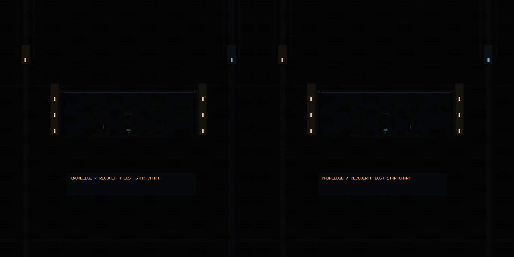
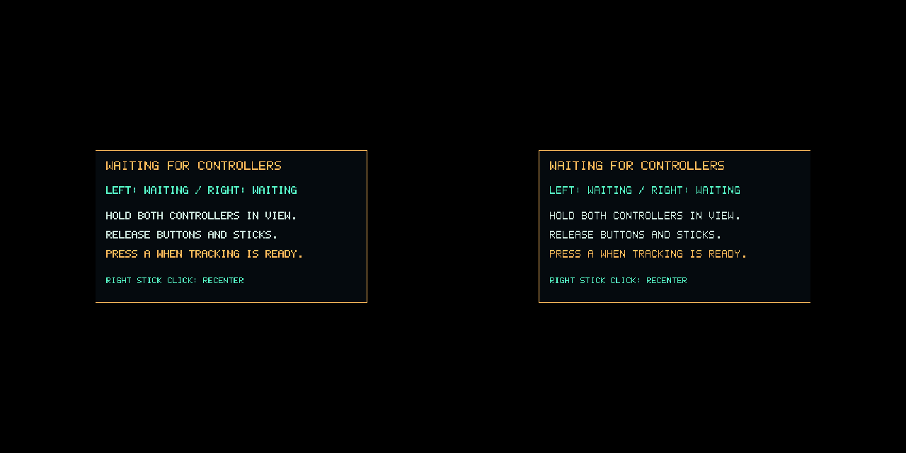

# Quest 3 projection framebuffer repair

The user's physical Quest 3 on Oculus Browser 154 reports build
`quest-framebuffer-recovery-2`, zero frames/eyes, no setup GL errors and
`0x8cd7` at **XR framebuffer binding**. That status is
`FRAMEBUFFER_INCOMPLETE_MISSING_ATTACHMENT`: the bound target has no images.
The zero pose/controller fields in that build occur because validation exits
before those fields are collected; they do not establish a tracking failure.

The earlier external device always attached a texture/depth buffer to its
opaque framebuffer. The new regression removes those actual attachments and
reproduces the same status against the old package. Enabling projection support
still fails against that package because it always selects the broken base target.
This reproduces the observed failure; it does not identify the private browser/
compositor operation responsible for the missing physical attachments.

The repair requests `layers` as an optional WebXR feature. When available and
granted, `XRWebGLBinding.createProjectionLayer` supplies standard 2D color/depth
textures. The bridge gets each view's images during its XR callback, attaches
them to an application-owned framebuffer and uses the supplied viewport. It
validates the target before simulation advances and still updates the game once
per headset frame. Missing compositor depth uses one reusable bounded depth
renderbuffer. Runtime textures are detached after the callback; only application
framebuffer/depth storage is deleted on exit or failure.

Browsers without granted/implemented projection layers retain the base-layer
path. Unsupported projection creation can fall back; invalid targets and real
graphics failures still stop safely with usable export/retry controls. The report
now identifies `quest-projection-framebuffer-3`, `renderTarget`, enabled features
and early detected headset/controllers even when binding fails.

The implementation follows the standard per-view texture binding used by
[Three.js's WebXR renderer](https://github.com/mrdoob/three.js/blob/dev/src/renderers/webxr/WebXRManager.js)
without adding that renderer or any framework dependency. It does not ignore
incompleteness or attach images to the runtime-owned opaque framebuffer.

Only the Quest bridge, external test device, targeted workflow invocation and
documentation change. Ordinary web rebuilds to byte-identical HTML/JS/WASM;
shared C sources/headers remain byte-identical. Generator 16, campaign 2, save 17,
live snapshot 2 and storage namespaces are unchanged. Extended CI remains opt-in.

The new regression covers real stereo output with a broken legacy target,
replacement runtime textures, missing depth/controllers, denied and unsupported
layers, safe rejection of missing/invalid targets, exit/re-entry and resource
ownership. Full gameplay is checked separately through the compatibility path
and the projection path. Packaging and isolated native Quest checks supplement
the browser execution.

Physical Quest startup, rendering speed and comfort remain unverified in this
environment. Reload the published Quest page and check that its report identifies
the new build and target. A device retry is needed to confirm this repair addresses
the reported hardware behavior. Existing saved expeditions can be continued.

## Executed verification

- The [old package fails](before.log), reproducing [missing attachments and zero eyes](reproduced-missing-attachment.json).
- Full base-layer and projection-texture runs each passed 14 check groups, including controllers, menus, locomotion, hacking, shelter, vehicles, imports and independent storage. Results are in [legacy-results.json](legacy-results.json) and [projection-results.json](projection-results.json).
- Review tightened preflight to validate both eye images before advancing simulation. The [final package passed all three focused startup groups](final-startup-results.json), including missing left/right images and a late right-eye failure with unchanged game time and eye count.
- Seven native Quest tests, the packaging test, five CI-tool tests, JavaScript/Python syntax and strict specifications passed. Ordinary HTML/JS/WASM and all shared C sources/headers match their pre-repair hashes.

[verification.json](verification.json) records scope and isolation hashes.
[recovered-report.json](recovered-report.json) identifies the new target path.
Framebuffer errors in the logs are deliberate failure injections, followed by
assertions about safe exit and retained export/retry controls.

The repair is published on `main` at `06ceae4`. All four target builds, fast
quality checks and Pages passed in [the release run](https://github.com/stbange/starship_crawl/actions/runs/43319335160).
The observed job states are retained in [release-ci.json](release-ci.json).
