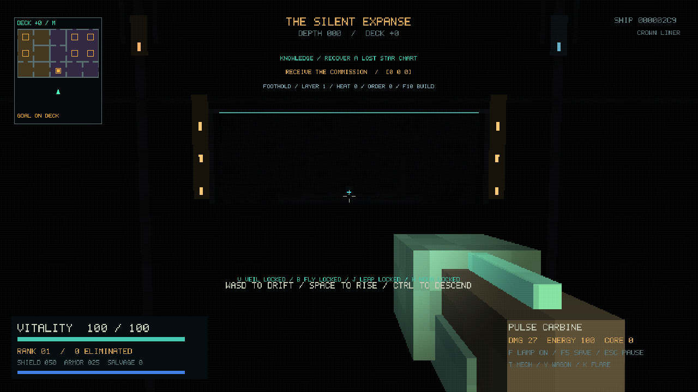
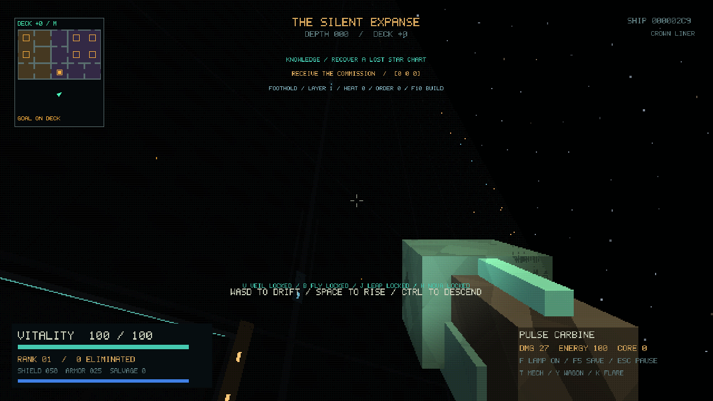
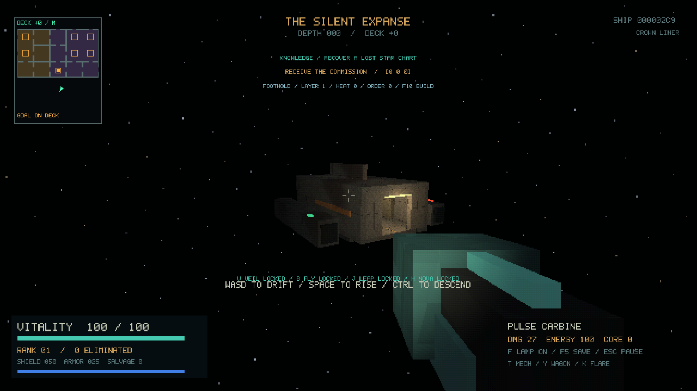

Actual native OpenGL captures of the generator-8 arrival, using seed 713 and the
retro renderer on Mesa. These show the same approach included in the web build.

Looking toward the loading bay (`--scene arrival`):

Looking along the hull toward distant lamps and open space (`--scene hull`):

Looking back at the boarding craft and its open hatch (`--scene skiff`):

