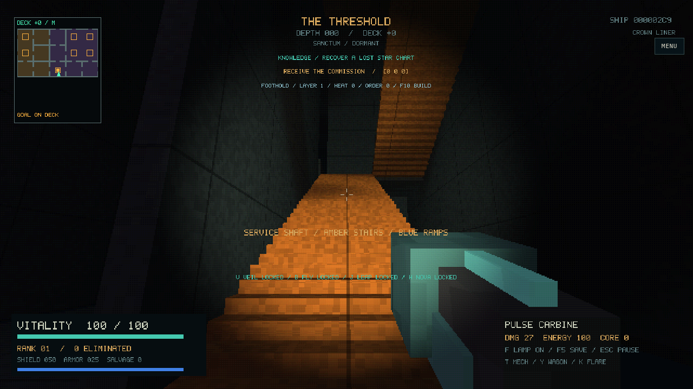
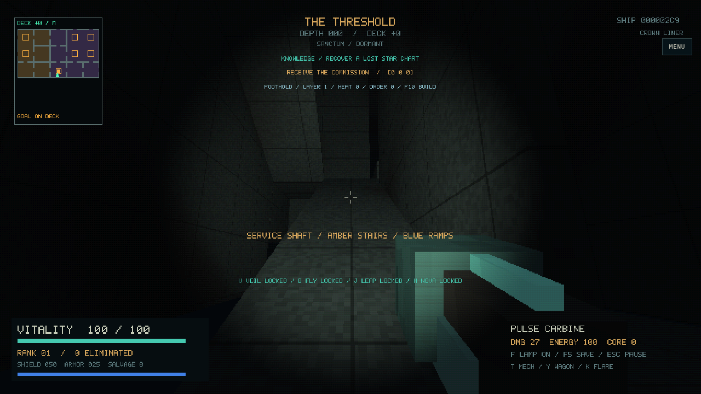
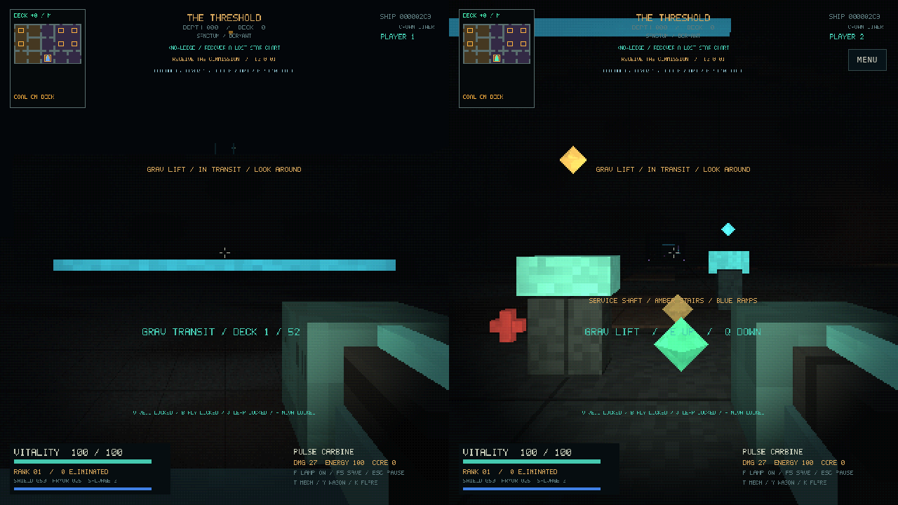

Actual native OpenGL captures of the generator-8 arrival, using seed 713 and the
retro renderer on Mesa. These show the same approach included in the web build.

Looking toward the loading bay (`--scene arrival`):

Looking along the hull toward distant lamps and open space (`--scene hull`):

Looking back at the boarding craft and its open hatch (`--scene skiff`):

Generator-9 traversal, captured from the packaged WASM/WebGL build using real
keyboard input and seed 713 (Chromium software rendering):

The [controls and traversal guide](../../FOUNDATIONS.md) includes reproducible
inspection scenes. The lift capture is from a normal expedition; the browser test
then saves during transit and verifies safe recovery at the departure pad.
