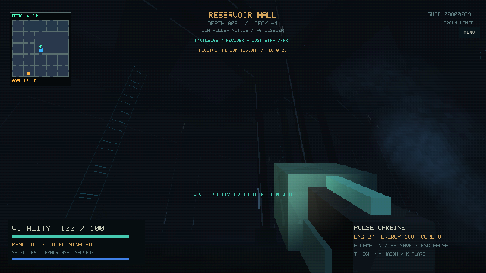
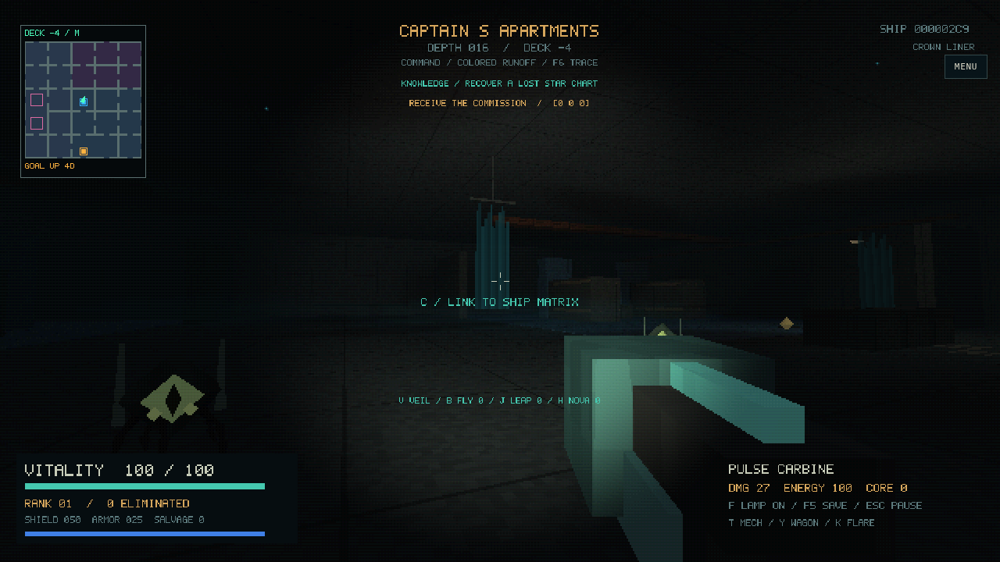
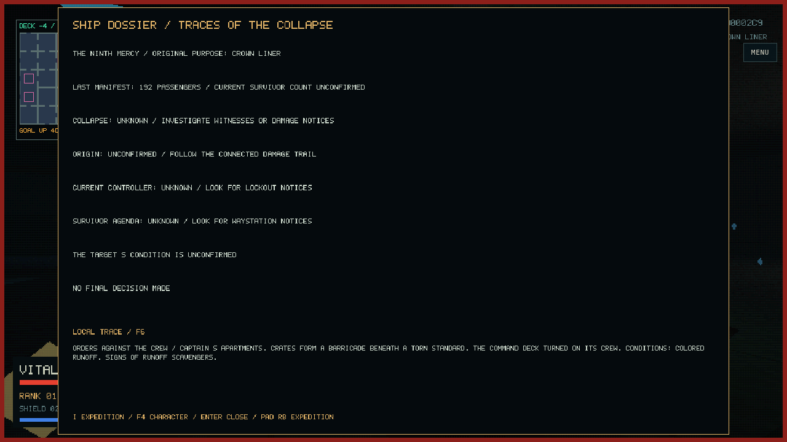
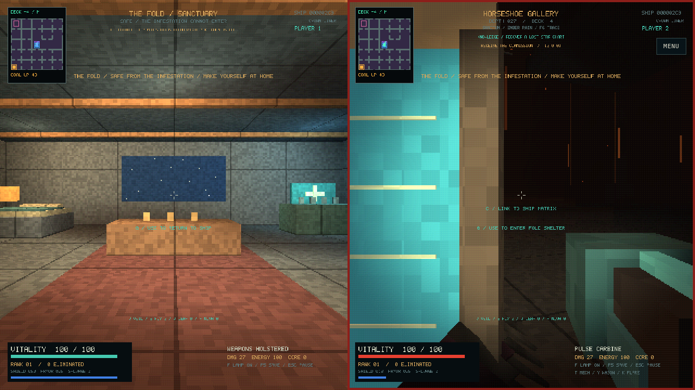
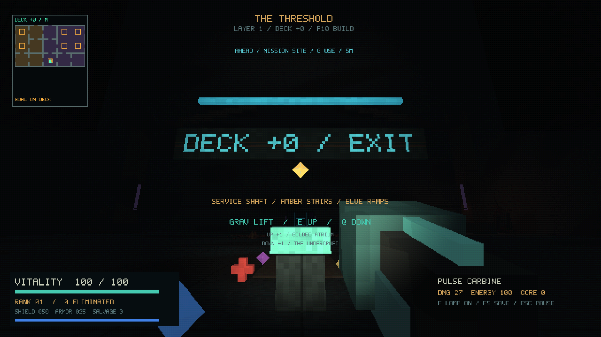

Actual native OpenGL captures of the generator-8 arrival, using seed 713 and the
retro renderer on Mesa. These show the same approach included in the web build.

Looking toward the loading bay (`--scene arrival`):

Looking along the hull toward distant lamps and open space (`--scene hull`):

Looking back at the boarding craft and its open hatch (`--scene skiff`):

Generator-9 traversal, captured from the packaged WASM/WebGL build using real
keyboard input and seed 713 (Chromium software rendering):

The [controls and traversal guide](../../FOUNDATIONS.md) includes reproducible
inspection scenes. The lift capture is from a normal expedition; the browser test
then saves during transit and verifies safe recovery at the departure pad.

Generator-10 WebGL captures from the packaged Chromium test, seed 713. These are
actual game frames; the low resolution and darkness are the game's retro renderer.
See [the living ship guide](../../LIVING_SHIP.md) for inspection scenes and controls.

The lower vault, looking towards the upper gallery:

Colored runoff, furniture evidence and pixel sprite details:

The current room's local account in the F6 dossier:

One player sheltered while the second remains in ship weather:

## Living tentacles

Actual native Mesa captures of the animated tentacle renderer, seed 713:

- [Rooted growth](tentacle-growth.png): a hooked floor tentacle with sucker rims and a faint violet tip beside its original root mat.
- [Gazer family](tentacle-gazers.png): floating eye creatures with trailing tentacles, including the larger brood variant.

Reproduce with `--scene tentacles` or `--scene form1`, `--seed 713 --smoke 100 --no-save`. The saving-disabled `tentacles` scene finds an actual botanical/infested room. Existing expeditions receive this rendering change without generating a new ship.

## Reliable exploration (P0)

Native Mesa capture of the current lift pad, readable deck sign and destination
previews. The HUD keeps the next action separate from the final map goal.

[Navigation changes and test evidence](../../NAVIGATION.md) ·
[Human checkpoints and device result sheet](../playtests/P0_CHECKLIST.md).
